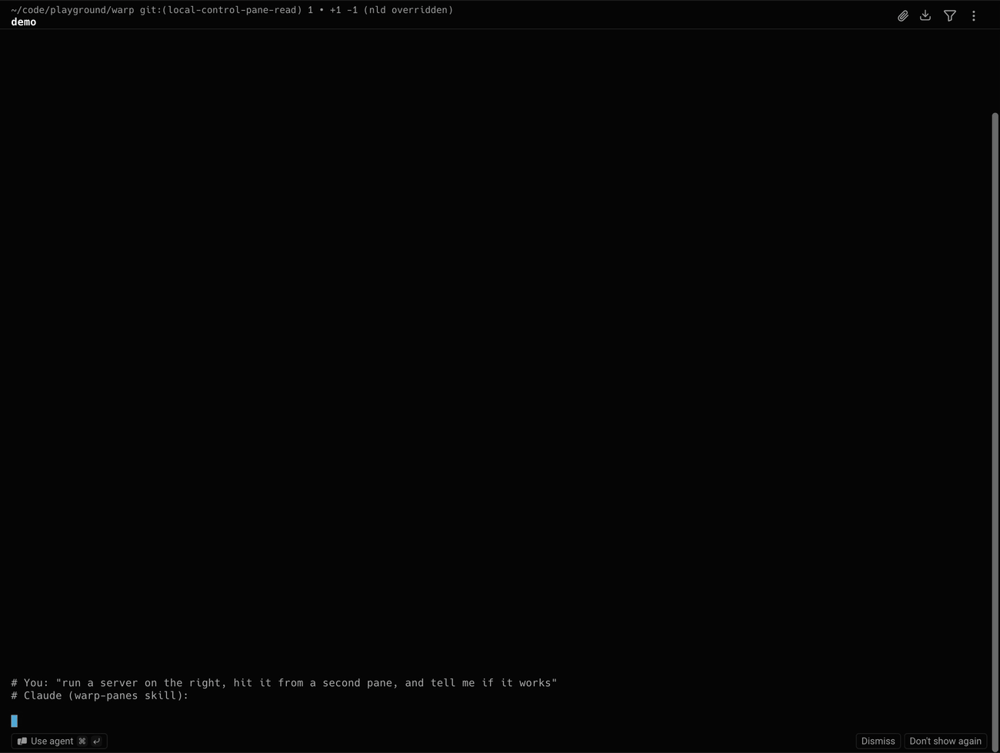

# Let Claude Code control your Warp panes

A guide for letting [Claude Code](https://claude.com/claude-code) work across your
[Warp](https://github.com/warpdotdev/warp) terminal: split panes, start a dev server
in another pane, and **read what other panes are showing** ("what's the dev server
saying?", "are the tests on the right green?").

Warp is open source and comes with a local control CLI (`warpctrl`) that can already
split panes and open tabs. It can't read a pane's output or run a command in another
pane, though, and it isn't turned on in builds you compile yourself. This repo adds
those pieces as three small patches (~150 lines), plus a Claude Code skill that
teaches Claude how to use them.



*The commands the skill has Claude run (scripted here for the recording): split two
panes, start a server in one and a client hitting it in the other, then read both
panes back and report.*

```
You:    start the dev server on the right and tell me when it's up
Claude: warpctrl-oss pane split --direction right
        warpctrl-oss input run --pane "<new pane>" "npm run dev"
        warpctrl-oss pane read --pane "<new pane>" --lines 40
        → "Server is listening on :3000, no errors."
```

> Tested on macOS only (Warp's local control is macOS-focused). Patches were made
> against Warp commit `fc4b06f` (2026-10-09).

## What's in here

| Path | What it is |
| --- | --- |
| `patches/0001-…pane.read…` | New `pane read` command: returns the visible text of a pane (the full-screen app if one is running, otherwise recent output + prompt). |
| `patches/0002-…OSS-builds…` | Turns on the `WarpControlCli` feature flag in self-built (OSS) Warp. |
| `patches/0003-…input.run…` | New `input run` command: runs a command in a given pane. If the pane's shell is still starting, the command waits until it's ready. |
| `bin/warpctrl-oss` | Small wrapper so you can call the CLI from your built app as `warpctrl-oss`. |
| `skill/warp-panes/SKILL.md` | The Claude Code skill: when to use the CLI, how to target panes, and safety rules. |

## Step-by-step

### 1. Get Warp building from source

```bash
git clone https://github.com/warpdotdev/warp.git ~/code/warp
cd ~/code/warp
./script/bootstrap   # one-time setup
./script/run         # build and launch, just to check it works
```

The first build takes a while. Don't continue until `./script/run` launches Warp.

### 2. Apply the patches

Use a branch so you can keep pulling upstream updates:

```bash
cd ~/code/warp
git checkout -b warp-panes
git am /path/to/this-repo/patches/*.patch
```

If `git am` stops on a conflict, Warp has changed those files since the patches
were made. Fix the conflict, then `git add` the files and run `git am --continue`.
The diffs are small and easy to follow.

Check that it still compiles and the tests pass:

```bash
cargo test -p local_control -p warp_cli
```

### 3. Build and launch the patched Warp

```bash
./script/run
```

This launches **WarpOss**, a separate app from your normal Warp. In WarpOss, open
**Settings → Scripting** and set local control to **Enabled**.

### 4. Install the `warpctrl-oss` wrapper

```bash
mkdir -p ~/.local/bin
cp /path/to/this-repo/bin/warpctrl-oss ~/.local/bin/
# If your checkout isn't at ~/code/warp, edit WARP_SRC in the script
# (or export WARP_SRC in your shell profile).
warpctrl-oss app ping
```

`app ping` should answer. If you see `no_instance` or `LocalControlDisabled`,
WarpOss isn't running or Scripting is still off.

Try it yourself before you hand it to Claude:

```bash
warpctrl-oss pane list --output-format json
warpctrl-oss pane split --direction right
warpctrl-oss pane read --pane-index 0 --lines 20
```

### 5. Install the Claude Code skill

```bash
mkdir -p ~/.claude/skills
cp -r /path/to/this-repo/skill/warp-panes ~/.claude/skills/
```

Start Claude Code **inside a WarpOss pane** and ask something like
*"split a pane on the right and run the tests there"*. Claude picks up the skill
on its own.

## Staying up to date with Warp

Keep the patches as a branch on top of upstream and rebase now and then:

```bash
cd ~/code/warp
git fetch origin
git rebase origin/master
./script/run
```

## Things to know

- **`input run` bypasses Claude Code's permission prompts.** A command typed into
  another pane isn't a Bash tool call, so Claude Code never asks you about it. The
  skill tells Claude to only run what it would run anyway, and to ask first before
  anything destructive or outward-facing, but those are instructions to the model,
  not something enforced. Know this before you use it.
- **Pane output is untrusted.** `pane read` returns whatever is on screen, and that
  could include text crafted to look like instructions. The skill tells Claude to
  treat it as data.
- **Pane IDs contain spaces** (e.g. `Pane Pane Terminal (2781)`), so quote them.
  When WarpOss isn't the focused app, index-based selectors fail, so use the IDs
  from `tab list` / `pane list` instead.
- This is a personal setup, not an official Warp feature. It may break when Warp
  changes its local control code.

## License

The patches modify Warp code licensed under AGPL-3.0, so they are AGPL-3.0 too
(see `patches/LICENSE-AGPL`). Everything else here (guide, skill, wrapper) is MIT.
